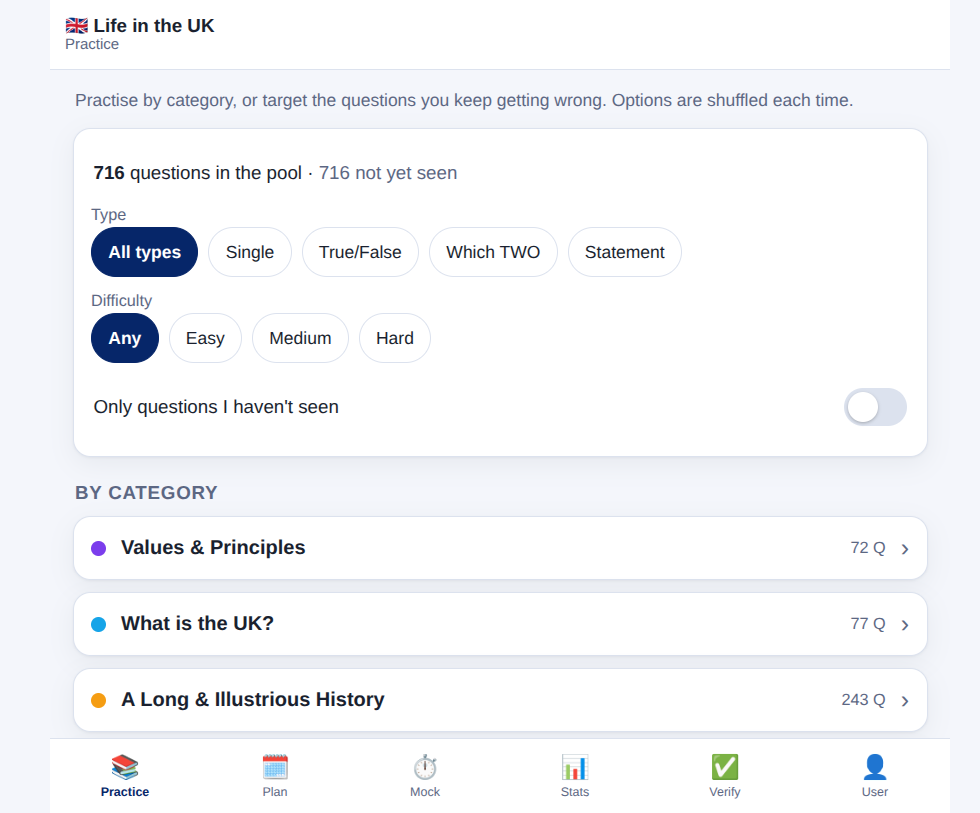

# Life in the UK Test — practice app

[](https://github.com/imnelsonchan-code/life-in-the-uk-test/actions/workflows/pages.yml)


A small, offline-friendly web app for practising the Life in the UK Test: drill by
category, sit timed mock tests, follow a study plan, review the questions you
keep getting wrong, and revise from a built-in cheat sheet.

> **Live site:** https://imnelsonchan-code.github.io/life-in-the-uk-test/



## Features

- **Practice by category** — 716 questions across the five handbook chapters,
  with filters for question type, difficulty and "only questions I haven't seen".
- **Timed mock tests** — 24 questions in 45 minutes, 18 to pass, with the real
  test's chapter weighting and a per-question review at the end.
- **Study plan** — choose a **4-week, 2-week or 1-week** schedule. Each day has
  its own reading, drilling and mock targets plus a one-click drill (including a
  combined **Ch 1 + Ch 2 sweep**), a "today" marker driven by your test date, and
  progress you tick off as you go (kept per plan). The written companion is
  [`STUDY_PLAN.md`](STUDY_PLAN.md).
- **Flag & review** — flag any question for a second look, then review your
  flagged questions or your wrong answers. The review screens show the question
  and options only; use *Practise these* to answer them and see the explanation.
- **Statistics** — seen/correct totals, per-category accuracy, mock history and
  your best score.
- **Cheat sheet** — the revision notes from [`Cheat_Sheet.md`](Cheat_Sheet.md),
  split by handbook chapter and built into its own tab, with a one-tap note
  button on every category row so you can jump straight to the chapter you are
  practising. Facts are current to 2026; where the handbook has moved on, the
  older figure is noted in brackets (see *The Cheat tab* below).
- **Multiple people** — optional named profiles, so several people can share one
  device without mixing up their progress (see *The User tab* below).
- **Project link** — a GitHub star button sits in the header (and a
  home-screen-style tile on the Practice home) pointing at the source repo, with
  its live star count.
- **Install it like an app** — a header button adds the site to your phone's home
  screen (see *Install it like an app* below), with its own icon, no browser
  chrome, and a service worker so it still opens without a connection.
- **Offline** — everything (progress included) lives in `localStorage`. There is
  no backend and no account, and no data ever leaves the device. The single
  optional network call is the GitHub star count; if it can't be reached, the
  number is hidden and the rest of the app is unaffected.

## Install it like an app

The ⬇ button in the header adds the site to your home screen so it launches like
any other app — full screen, its own icon, no address bar. It hides itself once
you are running the installed app, and it sits beside the GitHub link; neither
replaces the other.

Where a browser offers its own install prompt (Chrome and Edge on **Android**,
and Chromium on the desktop) the button fires that prompt — on Android that
builds a real WebAPK, with the maskable icon. Where it does not, the button
opens a step-by-step panel instead of a one-line toast, because on a phone you
need the steps in front of you while you work through the menus:

- **Android — Chrome** — ⋮ menu → *Install app* (or *Add to Home screen*) →
  *Install*.
- **Android — Samsung Internet** — ☰ → *Add page to* → *Home screen* → *Add*.
- **Android — Firefox** — ⋮ → *Install* (older builds: *Add to Home screen*).
- **iPhone / iPad** — only **Safari** can add a web app, so the panel says so if
  you are in Chrome, Firefox or Edge. In Safari: the **⋯ Page Menu** beside the
  address bar → **Share** → **Add to Home Screen**, leaving *Open as Web App*
  switched on. If the entry is missing, scroll to the bottom of the Share list,
  tap *Edit Actions* and switch *Add to Home Screen* on — a hidden entry there is
  the usual reason it "does not work".
- **Desktop** — the browser menu's *Install app* / *Add to Home screen*.

Under the hood that is a standard PWA: `app/manifest.webmanifest` (name, icons,
`display: standalone`, theme colour), the `app/icons/*.png` launcher icons, the
Apple meta tags (`apple-touch-icon`, `apple-mobile-web-app-capable`, so older
iPhones open it full screen too — iOS 26 does that by itself), and `app/sw.js`, a
service worker that serves the app from cache when the network is gone. The cache
is **network-first**, so a file can never go stale; the cache name carries the
same `?v=<commit>` as the rest of the assets, and a new deploy drops the old
cache. Set a test date and install it, and the app will tell you which day of the
plan you are on even with no signal.

## The Cheat tab

The **Cheat** tab holds the revision notes from
[`Cheat_Sheet.md`](Cheat_Sheet.md) — the quick-reference facts behind every
chapter, in the same order as the question pool:

- **Chapter chooser** — open the tab and you get the five chapters with how many
  sections each one has; tap one to read it.
- **Chapter chips** at the top of every chapter jump between chapters, and
  *All chapters* takes you back to the chooser.
- **📄 on every category row** — each category on the Practice home has a note
  button that opens its chapter directly, so you can read the facts for the
  chapter you are about to drill.
- **Facts are current to 2026.** Where the 3rd edition handbook has moved on —
  the Senedd's 96 members, the Commonwealth's 56, the 2021 census figures — the
  notes give the current position and put the older handbook figure in brackets,
  the same rule the questions follow.
- The sheet is cached with the rest of the app, so it reads offline too.

The notes are edited as plain markdown, then built into the app data:

```bash
node tools/build-cheatsheet.js   # Cheat_Sheet.md -> app/data/cheatsheet.json
```

The build pairs each `## Chapter N — Title` heading with the matching pool
category (so the notes and the questions can never drift apart), keeps your
sub-headings inside the chapter, and escapes the text. `node tools/test.js`
fails if `cheatsheet.json` is out of date with the markdown, so run the build
after editing the notes.

## The User tab — progress per person

The **User** tab keeps separate records for several people sharing one device.

- **Naming yourself is optional.** With no name the app just tracks "you"
  anonymously, exactly as it did before profiles existed.
- **Start tracking** — type a name and your progress is recorded under it. The
  *first* name you add adopts whatever you have already practised, so naming
  yourself never wipes your history.
- **Add person** — adds a second (third, …) person. Each one keeps their own
  seen/right/wrong set, flags, mock history, plan ticks and test date.
- **Switch** — tap a name under "People on this device" to make them active. The
  current person's state is parked and theirs is loaded, and a half-finished mock
  is parked with its owner too, so everyone resumes where they left off.
- **Rename** — edit the name field and press *Save name*.
- **Remove** — asks for confirmation. Removing the active person switches to the
  next one, or leaves a fresh empty record if they were the last.

Each row shows that person's shorthand progress (seen / accuracy / mocks), and
the panel above repeats their full numbers: seen, correct %, mocks, best mock,
plan days ticked.

## What's stored on your device

All of it lives in the browser's `localStorage`. There is no server, no account,
no cookie and no analytics:

| Key | What it holds |
| --- | --- |
| `liuk_state_v1` | The **active person's** progress: which questions you have `seen`, per-question `right`/`wrong` counts, your `flags`, the `mocks` history, the `plan` tick maps for all three plans, the `planId` you chose, and your `testDate` |
| `liuk_users_v1` | The roster of people on this device: names and ids, who is active, and the paused progress of everyone who is not |
| `liuk_active_mock_v1` | A mock test that is still in progress, so reloading the page resumes it instead of losing it |
| `liuk_gh_stars_v1` | The cached GitHub star count and when it was fetched — the only value that comes from the network |

A few consequences worth knowing:

- Progress belongs to the **browser**, not to a person or an account. Another
  browser, another OS profile, a private window, or clearing site data all start
  fresh — nothing syncs between devices.
- Nothing is ever uploaded. Your answers never leave the page, and the only
  outgoing request in the whole app is the optional star-count lookup.
- Clearing cookies and site data for this site erases everything, including
  every person on the roster.

## The question pool

| Chapter | Questions |
|---|---|
| The values and principles of the UK | 72 |
| What is the UK? | 77 |
| A long and illustrious history | 243 |
| A modern, thriving society | 164 |
| The UK government, the law and your role | 160 |
| **Total** | **716** |

Every question follows the schema in [`app/data/schema.md`](app/data/schema.md)
(`single`, `truefalse`, `two`, `statement`) and ships with an explanation and a
source note.

## Running it locally

The app is plain HTML/CSS/JS — no framework, no bundler, no `npm install`. Serve
the `app/` folder with anything:

```bash
python3 -m http.server 8899 --directory app     # then open http://localhost:8899
```

Or with Docker (nginx, rebuilds the image):

```bash
LIFE_IN_UK_PORT=8090 docker compose up -d --build   # then open http://localhost:8090
```

## Working on the questions

`app/data/parts/*.json` holds the source questions. `app/data/questions/*.json`
is the merged pool the app actually loads — regenerate it after editing parts:

```bash
node tools/merge.js        # parts -> app/data/questions (+ index.json)
node tools/validate.js     # schema and invariant checks
node tools/test.js         # regression suite (133 checks)
```

Browser end-to-end tests run against a live server (they drive the system Chrome
over the DevTools protocol, no dependencies to install):

```bash
node tools/e2e.js --base=http://localhost:8090          # all suites
node tools/e2e.js --only=plan --base=http://localhost:8090
```

Other helpers: `tools/stats.js` (pool breakdown), `tools/dupes.js`
(near-duplicate detection), `tools/find.js` (locate a question by id),
`tools/verify-sheet.js` (markdown checklists for reading the pool against the
handbook), and `tools/build-cheatsheet.js` (rebuilds the cheat sheet — see *The
Cheat tab*).

The fact-checking notes for the current pool are in
[`verify/`](verify/fact-check-2026-10-19.md).

## Project structure

```
app/                     the site — this directory is what gets deployed
  index.html
  css/styles.css
  js/app.js              the whole application
  manifest.webmanifest   PWA metadata for "Add to Home Screen"
  sw.js                  service worker: offline cache
  icons/                 launcher / favicon / apple-touch icons
  data/questions/        merged pool loaded at runtime
  data/parts/            source questions (edit these)
  data/cheatsheet.json   the cheat sheet, built from Cheat_Sheet.md
  data/schema.md         question schema
docker/                  nginx config for the container
docs/                    README assets
Cheat_Sheet.md           the revision notes (source of the cheat sheet)
tools/                   data pipeline, tests and the e2e harness
  build-cheatsheet.js    Cheat_Sheet.md -> app/data/cheatsheet.json
  make-icons.py          regenerates app/icons from one design (needs Pillow)
verify/                  fact-check reports
.github/workflows/       GitHub Pages deploy workflow
```

## Deployment

Hosting is a standard **GitHub Pages** site built by
[`.github/workflows/pages.yml`](.github/workflows/pages.yml). On every push to
`main` the workflow:

1. runs `node tools/validate.js` and `node tools/test.js` (a red build blocks the deploy),
2. stamps the CSS/JS/manifest URLs in `index.html` with the commit SHA, so
   browsers never serve a stale app after a release (the service worker reads
   that same stamp to name its cache),
3. uploads only the `app/` directory and deploys it to Pages.

So the published site is exactly the tested, committed `app/` folder — and it
lands at `https://<user>.github.io/<repo>/`.

## A note on content

This is an independent study aid. It is **not** affiliated with, endorsed by, or
connected to the Home Office, PSI, or the official *Life in the UK* handbook. All
questions here are original, written from publicly available facts, and the
explanations are our own wording — no third-party question bank or PDF is
included in this repository. The cheat sheet is the author's own revision notes,
summarised from personal study of the handbook. Always treat the official
handbook as the source of truth.

## Credits

Built for personal study. Questions and explanations written for this project;
the fact-checking pass is documented in `verify/`.
